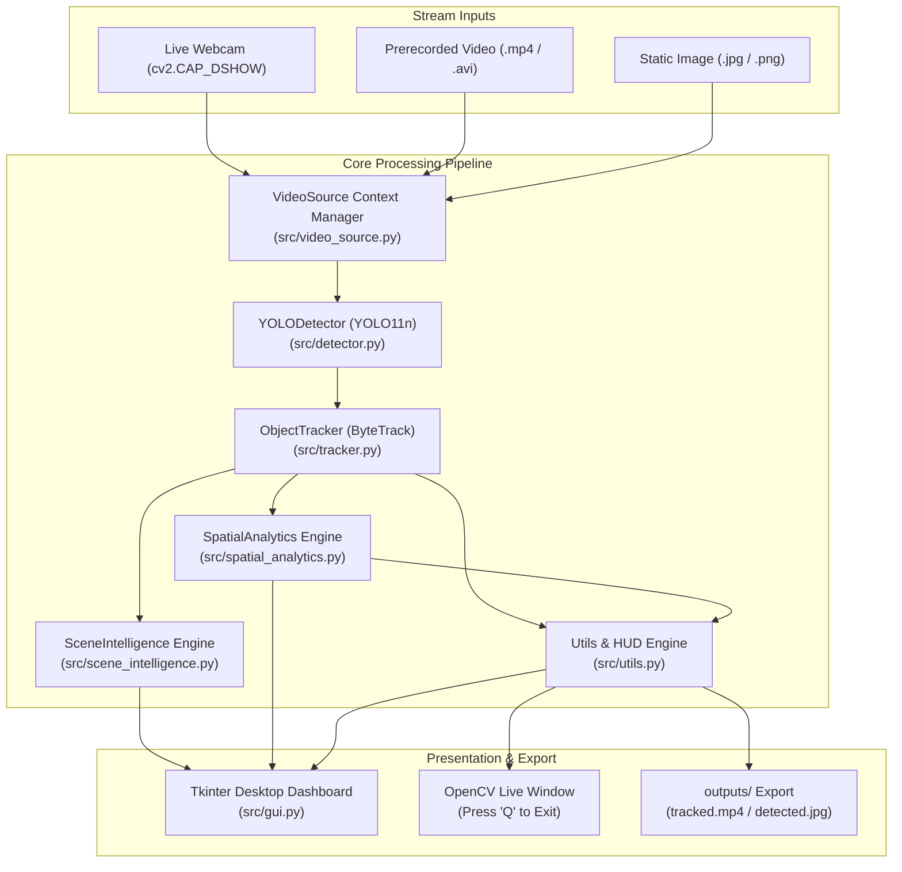

# CodeAlpha AI Internship — Task 4: Object Detection and Tracking

> **Real-Time Multi-Object Detection and Tracking with Ultralytics YOLO & ByteTrack**

[](https://www.python.org/)
[](https://docs.ultralytics.com/)
[](https://github.com/ifzhang/ByteTrack)
[](https://opencv.org/)
[](https://pytorch.org/)
[]()
[](LICENSE)

---

## 📌 Project Overview

This repository contains the complete implementation of **Task 4: Object Detection and Tracking** for the **CodeAlpha AI Internship**.

The application detects, tracks, and monitors objects across consecutive video frames from **live webcams**, **prerecorded video files**, and **static photographs**. It integrates state-of-the-art **Ultralytics YOLO (YOLO11n)** for deep learning inference with **ByteTrack** for temporal ID association, accompanied by a **desktop GUI dashboard**, a **CLI interface**, an **explainable Scene Intelligence engine**, and **virtual line-crossing & region analytics**.

> [!NOTE]
> **Pretrained Weights & ID Semantics**: The system employs official pretrained COCO weights (`yolo11n.pt`). Tracking IDs (e.g., `#1`, `#2`) are temporal stream identifiers assigned dynamically across consecutive frames using Kalman filter state prediction and Hungarian linear assignment. They are valid for the duration of the stream and are not persistent biometric or biometric facial recognizers.

---

## 🏗️ System Architecture



---

## ✨ Key Features

* **Real-Time Object Detection**: Inference with bounding boxes, confidence scores, and COCO class classifications via pretrained YOLO11n.
* **ByteTrack Multi-Object Tracking**: Associative tracking preserving persistent IDs across consecutive frames with zero ID hopping.
* **Virtual Line-Crossing & Region Analytics**: Geometric 2D line crossing detection with directional classification (`A_TO_B`, `B_TO_A`, `TOP_TO_BOTTOM`, `LEFT_TO_RIGHT`), dual-boundary hysteresis jitter suppression, and rectangular ROI entry/exit/occupancy tracking with track-loss discrimination and state recovery.
* **Explainable Scene Intelligence**: Snapshot counting, jitter-filtered motion direction estimation (Stationary, Left, Right, Up, Down), structured event timeline logging (`ENTERED`, `MOVED`, `EXITED`), and deterministic natural-language scene summaries without external LLM dependencies.
* **Motion Trajectory Trails**: Centroid path visualization tracing the historical movement trajectory of each tracked entity.
* **Live Analytics Heads-Up Display (HUD)**: On-screen telemetry showing real-time processing FPS, active track count, cumulative unique IDs, and per-class distribution.
* **Interactive Desktop GUI Dashboard**: Dark-themed desktop dashboard built with Tkinter and Pillow featuring threaded video streaming, start/stop controls, live scene intelligence cards, spatial analytics counters, and real-time activity logs.
* **Live Webcam Streaming**: Webcam integration supporting camera index selection and responsive `Q` / `Esc` keyboard exit handlers.
* **Prerecorded Video Processing**: Process `.mp4`, `.avi`, `.mov`, and `.mkv` files with automated video export to `outputs/`.
* **Single-Image Verification**: Fast CLI mode to verify detection accuracy on static photographs.
* **Resource Safety & Graceful Recovery**: Python context managers ensuring OpenCV video streams, writer handles, and GUI worker threads release cleanly on exit.

---

## 🛠️ Technology Stack

| Component | Library / Framework | Version | Purpose |
| :--- | :--- | :--- | :--- |
| **Language** | Python | `3.13.2` | Core programming language |
| **Object Detection** | Ultralytics YOLO | `8.4.177` (YOLO11n) | Object detection & classification |
| **Object Tracking** | ByteTrack / BoT-SORT | Built-in (`lap 0.5.13`) | Multi-object association & ID assignment |
| **Spatial Analytics** | Pure Python & NumPy | Built-in | 2D vector cross-products, hysteresis boundaries, ROI occupancy |
| **Scene Intelligence** | Pure Python & NumPy | Built-in | Centroid motion vectors, timeline events, explainable summaries |
| **Computer Vision** | OpenCV (`opencv-python`) | `5.0.0` | Frame acquisition, image manipulation, DirectShow capture |
| **Tensors** | PyTorch & Torchvision | `2.14.1+cpu` | Neural network computation (with CUDA fallback) |
| **GUI Framework** | Tkinter + Pillow (`PIL`) | Built-in / `12.3.0` | Native desktop dashboard |
| **Testing** | PyTest | `9.1.1` | Automated test suite (64 unit & integration tests) |

---

## 📂 Project Structure

```text
CodeAlpha_Object_Detection_Tracking/
├── app.py                       # Unified CLI and application controller
├── requirements.txt             # Pinned project dependencies
├── README.md                    # Project documentation & usage guidelines
├── .gitignore                   # Excluded environments, weights, outputs, and caches
├── .vscode/
│   └── settings.json            # VS Code Python interpreter binding
├── src/
│   ├── __init__.py              # Package root
│   ├── detector.py              # YOLODetector: model loader & inference engine
│   ├── tracker.py               # ObjectTracker & TrackedObject: ByteTrack association
│   ├── scene_intelligence.py   # SceneIntelligence: rule-based motion analytics & events
│   ├── spatial_analytics.py    # SpatialAnalytics: line crossing, ROI occupancy & hysteresis
│   ├── video_source.py          # VideoSource: webcam & file stream context manager
│   ├── utils.py                 # HUD rendering, bounding boxes, palettes, FPS meter
│   └── gui.py                   # Desktop GUI dashboard & background tracking worker
├── tests/
│   ├── __init__.py              # Test suite init
│   ├── test_project_setup.py    # 23 automated baseline and architecture tests
│   ├── test_scene_intelligence.py # 13 deterministic scene intelligence tests
│   └── test_spatial_analytics.py # 28 deterministic line-crossing & ROI analytics tests
├── assets/                      # Test media (sample_bus.jpg, sample_clip.mp4)
├── models/                      # Pretrained YOLO weights (yolo11n.pt) [git-ignored]
└── outputs/                     # Annotated output videos & images [git-ignored]
```

---

## 🚀 Setup & Installation

### 1. Prerequisites
* Python 3.10+ (Tested on Python 3.13 64-bit on Windows 11)
* Git

### 2. Virtual Environment Setup

```powershell
# Navigate to project directory
cd CodeAlpha_Object_Detection_Tracking

# Create virtual environment
python -m venv venv

# Activate on Windows PowerShell:
.\venv\Scripts\Activate.ps1
# Or on Command Prompt:
.\venv\Scripts\activate.bat
```

### 3. Install Dependencies

```powershell
pip install -r requirements.txt
```

---

## 💻 Usage & Running

### Mode 1: Launch the Interactive Desktop GUI Dashboard

```powershell
python app.py --gui
```
* **Dashboard Controls**:
  * Select **Webcam** or **Video File** input.
  * Adjust the **Confidence Threshold** slider.
  * Select tracker (**ByteTrack** or **BoT-SORT**).
  * Toggle **Save Annotated Output**.
  * Click **▶ Start Tracking** to stream with real-time HUD and stats.
  * Click **⏹ Stop Tracking** to halt and save outputs cleanly.

---

### Mode 2: Live Interactive Webcam Tracking (CLI)

```powershell
# Run live tracking on default webcam (index 0)
python app.py --source 0 --model yolo11n.pt --tracker bytetrack.yaml --conf 0.25

# Save webcam session output video with spatial demo analytics
python app.py --source 0 --spatial-demo --save
```
* **Keyboard Controls**:
  * Press **`q`** or **`Q`** to quit the live camera stream.
  * Press **`Esc`** to quit and release camera hardware safely.

---

### Mode 3: Prerecorded Video Tracking (CLI)

```powershell
# Run ByteTrack tracking on a recorded video and save annotated MP4
python app.py --source assets/sample_clip.mp4 --model yolo11n.pt --tracker bytetrack.yaml --save

# Run with interactive virtual line crossing and rectangular ROI demo
python app.py --source assets/sample_clip.mp4 --spatial-demo --save

# Run with custom virtual line and ROI coordinates
python app.py --source assets/sample_clip.mp4 --line 50,240,590,240 --roi 120,100,520,380 --save

# Limit processing to first 30 frames
python app.py --source assets/sample_clip.mp4 --max-frames 30 --save
```

---

### Mode 4: Single-Image Object Detection (CLI)

```powershell
# Run YOLO detection on a photo and save to outputs/
python app.py --source assets/sample_bus.jpg --model yolo11n.pt --conf 0.25 --save
```

---

## ⚙️ CLI Parameter Reference

| Argument | Type | Default | Description |
| :--- | :---: | :---: | :--- |
| `--gui` | Flag | `False` | Launches the desktop GUI dashboard |
| `--source` | String | `0` | Input source: camera index (`0`, `1`), image file, or video file |
| `--model` | String | `yolo11n.pt` | Pretrained YOLO weights filename or path |
| `--tracker` | String | `bytetrack.yaml` | Multi-object tracker (`bytetrack.yaml` or `botsort.yaml`) |
| `--conf` | Float | `0.25` | Confidence threshold between `0.0` and `1.0` |
| `--device` | String | `cpu` | Inference device (`cpu` or `cuda`) |
| `--line` | String | `None` | Virtual line coordinates formatted as `x1,y1,x2,y2` |
| `--roi` | String | `None` | Rectangular ROI coordinates formatted as `x1,y1,x2,y2` |
| `--spatial-demo` | Flag | `False` | Enables default demo line and ROI overlays and counters |
| `--save` | Flag/Path | `None` | Save annotated video or image to `outputs/` |
| `--max-frames`| Integer | `None` | Stop processing after $N$ frames |
| `--headless` | Flag | `False` | Run webcam processing headlessly without OpenCV window |

---

## 📊 Measured Performance & Benchmarks

All performance measurements below were executed on the actual host hardware (Intel/AMD x64 CPU on Windows 11):

| Mode / Input | Hardware Mode | Cold Start (Model Init) | Sustained Latency | Sustained Throughput |
| :--- | :---: | :---: | :---: | :---: |
| **Webcam Stream (640×480)** | CPU (`PyTorch 2.14.1+cpu`) | `3.14 s` | `94.7 ms` / frame | **`10.56 FPS`** |
| **Prerecorded Video (720×1280)** | CPU (`PyTorch 2.14.1+cpu`) | `2.80 s` | `136.6 ms` / frame | **`7.31 FPS`** |
| **Static Photo (810×1080)** | CPU (`PyTorch 2.14.1+cpu`) | `2.10 s` | `2.32 s` (single frame) | N/A |

> [!TIP]
> **GPU Acceleration**: On machines equipped with an NVIDIA GPU and CUDA drivers installed, running `--device cuda` reduces inference latency to <15 ms per frame, enabling 60+ FPS processing.

---

## 🧠 Phase A — Advanced Scene Intelligence

The system includes an explainable, rule-based **Scene Intelligence** layer ([`src/scene_intelligence.py`](src/scene_intelligence.py)) that sits on top of ByteTrack temporal association. It turns raw spatial coordinates into explainable metrics, temporal timeline events, and deterministic natural-language summaries.

### 1. Scene Snapshot & Cumulative Metrics
* Tracks currently visible objects per frame alongside total cumulative entities seen throughout the video session.
* Maintains per-class counts (`person`, `car`, `dog`, etc.) updated every frame without duplicate ID inflation.

### 2. Motion Direction Estimation & Jitter Suppression
* Tracks Euclidean centroid displacement $(\Delta x, \Delta y)$ across a moving window:
  $$\text{Displacement} = \sqrt{(\Delta x)^2 + (\Delta y)^2}$$
* **Jitter Filter**: Centroid drift under $12.0\text{px}$ is categorized as `STATIONARY`, eliminating detection noise and bounding box jitter.
* **Dominant Direction Axis**: When net movement $\ge 12.0\text{px}$, the engine decomposes motion into 4 coarse vectors:
  * $|\Delta x| \ge |\Delta y|$: `MOVING_LEFT` ($\Delta x < 0$) or `MOVING_RIGHT` ($\Delta x > 0$)
  * $|\Delta y| > |\Delta x|$: `MOVING_UP` ($\Delta y < 0$) or `MOVING_DOWN` ($\Delta y > 0$)

### 3. Structured Event Timeline Logging
Emits three deterministic event types logged to GUI and CLI feeds:
* `ENTERED`: Emitted when a new tracking ID is first registered in the scene.
* `MOVED`: Emitted when an entity exhibits persistent directional motion. Throttled (every 20 frames or on direction change) to prevent event flood.
* `EXITED`: Emitted when an object disappears for $\ge 15$ consecutive frames, or when the video stream finalizes.

### 4. Deterministic Natural-Language Summaries
* Generates human-readable, factual summaries synthesized directly from tracked observations (e.g., *"Observed 5 distinct objects (4 persons, 1 bus) across 30 frames. Currently visible (5)... Motion highlights: #1 bus covered ~142px."*).
* Zero ungrounded generative hallucinations: runs 100% locally on CPU without third-party LLM API keys.

> [!NOTE]
> **Explainability & Limitations**: Scene intelligence operates strictly within 2D image coordinates. Apparent motion reflects camera-plane pixel displacement rather than calibrated real-world velocity or 3D world motion. Stationary camera setups yield highest directional fidelity.

---

## 📐 Phase B — Virtual Line-Crossing & Region Analytics

The system features a dedicated, explainable spatial-analytics layer ([`src/spatial_analytics.py`](src/spatial_analytics.py)) that computes geometric line-crossing detections and rectangular Region of Interest (ROI) occupancy metrics on top of ByteTrack temporal track histories.

### 1. Mathematical Formulation of Line Crossing

Given a user-defined virtual line segment $L$ connecting endpoints $P_1(x_1, y_1)$ and $P_2(x_2, y_2)$, and a tracked entity's consecutive centroid positions $C_{prev}(x_{prev}, y_{prev})$ and $C_{curr}(x_{curr}, y_{curr})$:

1. **Signed Perpendicular Distance**:
   The perpendicular signed distance from a point $P(x, y)$ to the infinite line passing through $P_1$ and $P_2$ is computed via the 2D vector cross-product:
   $$d(P) = \frac{(x_2 - x_1)(y - y_1) - (y_2 - y_1)(x - x_1)}{\sqrt{(x_2 - x_1)^2 + (y_2 - y_1)^2}}$$

2. **Hysteresis Band & Boundary Jitter Suppression**:
   To prevent false crossings caused by sensor noise, bounding box jitter, or stationary objects straddling the line, a dual-sided hysteresis dead-band of $\pm h$ ($h = 8.0\,\text{px}$) is enforced:
   * **Side A**: $d(P) > +h$
   * **Neutral / Dead Zone**: $-h \le d(P) \le +h$
   * **Side B**: $d(P) < -h$
   A transition is registered only when an object moves strictly from outside one hysteresis boundary to beyond the opposing hysteresis boundary.

3. **Trajectory Segment Straddle & Intersection**:
   In addition to distance signs, the trajectory segment $\overline{C_{prev} C_{curr}}$ must geometrically intersect the finite segment $\overline{P_1 P_2}$ (with an endpoint tolerance $\epsilon = 0.15$ to capture fast-moving oblique tracks).

4. **Directional Semantics**:
   * **Horizontal Virtual Lines** ($|x_2 - x_1| \ge |y_2 - y_1|$): Classified as `TOP_TO_BOTTOM` ($y_{curr} > y_{prev}$) or `BOTTOM_TO_TOP` ($y_{curr} < y_{prev}$).
   * **Vertical Virtual Lines** ($|y_2 - y_1| > |x_2 - x_1|$): Classified as `LEFT_TO_RIGHT` ($x_{curr} > x_{prev}$) or `RIGHT_TO_LEFT` ($x_{curr} < x_{prev}$).
   * **Arbitrary Diagonal Lines**: Classified as `SIDE_A_TO_B` or `SIDE_B_TO_A` relative to the line orientation vector.
   * **Cooldown Guard**: Consecutive crossings for the same tracking ID are throttled (cooldown of 10 frames) to eliminate oscillation.

### 2. Rectangular Region of Interest (ROI) Analytics

Configured as a bounding box $[x_1, y_1, x_2, y_2]$ defining a monitored zone (e.g. entrance foyer, restricted perimeter, parking bay):

1. **Dual-Boundary Spatial Hysteresis**:
   To prevent rapid toggling when an object's centroid lingers on an ROI boundary edge:
   * **Inner Entry Boundary**: $R_{inner} = [x_1 + h, y_1 + h, x_2 - h, y_2 - h]$
   * **Outer Exit Boundary**: $R_{outer} = [x_1 - h, y_1 - h, x_2 + h, y_2 + h]$
   An object enters only upon crossing inside $R_{inner}$, and exits only upon crossing completely outside $R_{outer}$.

2. **Track-Loss vs. Boundary Exit Discrimination**:
   A critical failure mode of naive ROI trackers is counting an "exit" when an object simply disappears or is occluded while still standing inside the zone. The system enforces strict spatial attribution:
   * **Boundary Exit (`ROI_EXIT`)**: Emitted **only** when an active track's centroid is observed transitioning from inside $R_{inner}$ to strictly outside $R_{outer}$.
   * **Detection Loss / Stream Conclusion (`TERMINATED_INSIDE`)**: If a track is lost (unseen for $\ge 10$ frames) or if the stream concludes while the entity is inside the ROI, it transitions to `TERMINATED_INSIDE`. It is logged separately and is **never** counted as a false exit.

### 3. Telemetry, Overlays & Reporting

* **Visual Overlays**: Virtual line rendered in bright cyan with direction indicator arrows; rectangular ROI rendered in dashed/solid amber with active occupancy badge.
* **Per-Class Counters**: Cumulative line crossings, ROI entries, and ROI exits broken down by entity classification (`person`, `car`, `truck`, etc.).
* **GUI Dashboard Integration**: Live "Spatial Analytics" telemetry card and real-time activity log feed, toggled via a dedicated sidebar checkbox.
* **CLI Reporting**: Rich terminal summaries showing crossing distributions, ROI entries/exits, terminated counts, and chronological spatial event timestamps.

> [!NOTE]
> **2D Perspective Limitations**: Spatial calculations assume an orthographic or semi-orthographic view onto the 2D image plane. Centroids represent object pixel centers rather than 3D ground contact footprints. For perspective-heavy cameras, placing the virtual line or ROI near the lower third of the frame delivers highest physical fidelity.

---

## 🧪 Automated Test Suite

A 64-point unit and integration test suite is located in [`tests/test_project_setup.py`](tests/test_project_setup.py), [`tests/test_scene_intelligence.py`](tests/test_scene_intelligence.py), and [`tests/test_spatial_analytics.py`](tests/test_spatial_analytics.py).

```powershell
pytest tests/ -v
```

### Test Coverage Highlights:
* **Environment & Compatibility (2 tests)**: Python version validation and dependency imports.
* **Architecture & Detection (12 tests)**: Lazy model loading, frame validation, geometry (`width`, `height`, `area`, `center`), HUD pipeline, and CLI entrypoint helpers.
* **Tracking & ByteTrack (6 tests)**: ByteTrack initialization, centroid trajectories, empty frame handling, stream isolation, and real video tracking on sample clip.
* **Webcam & Desktop GUI (3 tests)**: DirectShow device error handling, threaded tracking worker lifecycle, and Tkinter UI initialization/teardown.
* **Scene Intelligence & Analytics (13 tests)**: Empty detections handling, multi-class snapshot counting, jitter suppression, 4-direction motion estimation, missing history validation, disappearing object grace periods, stream finalization cleanup, duplicate movement throttling, session isolation/reset, natural-language summary traceability, malformed input fallbacks, and video tracking integration.
* **Spatial Analytics & Geometry (28 tests)**: Line coordinate validation, zero-length line rejection, out-of-bounds line handling, invalid tuple length rejection, ROI coordinate validation, inverted/zero-area ROI rejection, negative ROI rejection, out-of-bounds ROI handling, integer and whole-valued float string coordinate parsing, fractional and non-finite rejection, empty track handling, horizontal line crossing (top-to-bottom and bottom-to-top), approach-and-reverse without crossing rejection, boundary jitter suppression, ROI entry/exit cycles, inside occupancy without duplicate entries, temporary detection grace periods, track termination inside without false exits, terminated-inside track state recovery and clean re-entry, stream finalization cleanup, multi-class/multi-ID telemetry counters, bounded event history enforcement, session reset and isolation, synthetic frame overlay drawing, and end-to-end video tracking integration with spatial analytics.

---

## 🔧 Troubleshooting & Common Questions

1. **Webcam Backend on Windows**:
   * Windows uses the DirectShow backend (`cv2.CAP_DSHOW`) automatically for fast, reliable hardware initialization. If multiple cameras are attached, select `--source 1` or specify the camera index in the GUI.
2. **Missing Video File Error**:
   * Provide a valid file path or use forward slashes / escaped backslashes (e.g. `assets/sample_clip.mp4`).
3. **Weight Caching**:
   * Pretrained weights (`yolo11n.pt`) are downloaded automatically on first use into `models/` and are strictly excluded from Git tracking via `.gitignore`.

---

## 👨‍💻 Author

* **Organization**: CodeAlpha
* **Internship**: Artificial Intelligence Internship
* **Task**: Task 4 — Object Detection and Tracking
* **Author**: Nathin Gowda K G
