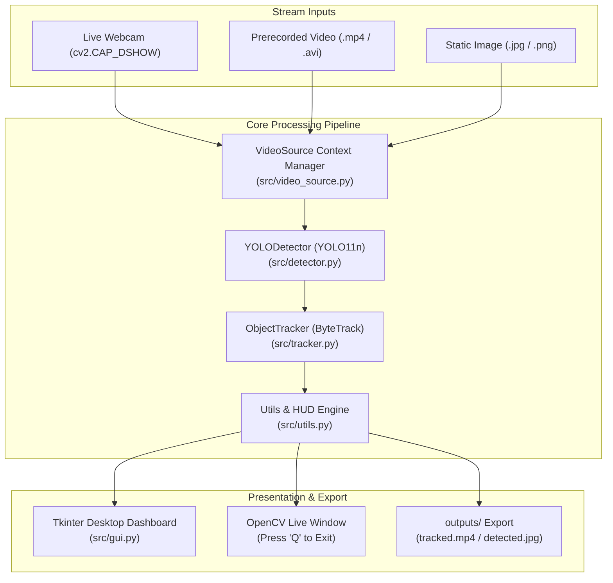

# CodeAlpha AI Internship — Task 4: Object Detection and Tracking

> **Real-Time Multi-Object Detection and Tracking with Ultralytics YOLO & ByteTrack**

[](https://www.python.org/)
[](https://docs.ultralytics.com/)
[](https://github.com/ifzhang/ByteTrack)
[](https://opencv.org/)
[](https://pytorch.org/)
[]()
[](LICENSE)

---

## 📌 Project Overview

This repository contains the complete implementation of **Task 4: Object Detection and Tracking** for the **CodeAlpha AI Internship**.

The application detects, tracks, and monitors objects across consecutive video frames from **live webcams**, **prerecorded video files**, and **static photographs**. It integrates state-of-the-art **Ultralytics YOLO (YOLO11n)** for deep learning inference with **ByteTrack** for temporal ID association, accompanied by a **desktop GUI dashboard** and a **CLI interface**.

> [!NOTE]
> **Pretrained Weights & ID Semantics**: The system employs official pretrained COCO weights (`yolo11n.pt`). Tracking IDs (e.g., `#1`, `#2`) are temporal stream identifiers assigned dynamically across consecutive frames using Kalman filter state prediction and Hungarian linear assignment. They are valid for the duration of the stream and are not persistent biometric or biometric facial recognizers.

---

## 🏗️ System Architecture



---

## ✨ Key Features

* **Real-Time Object Detection**: Inference with bounding boxes, confidence scores, and COCO class classifications via pretrained YOLO11n.
* **ByteTrack Multi-Object Tracking**: Associative tracking preserving persistent IDs across consecutive frames with zero ID hopping.
* **Motion Trajectory Trails**: Centroid path visualization tracing the historical movement trajectory of each tracked entity.
* **Live Analytics Heads-Up Display (HUD)**: On-screen telemetry showing real-time processing FPS, active track count, cumulative unique IDs, and per-class distribution.
* **Interactive Desktop GUI Dashboard**: Dark-themed desktop dashboard built with Tkinter and Pillow featuring threaded video streaming, start/stop controls, and settings.
* **Live Webcam Streaming**: Webcam integration supporting camera index selection and responsive `Q` / `Esc` keyboard exit handlers.
* **Prerecorded Video Processing**: Process `.mp4`, `.avi`, `.mov`, and `.mkv` files with automated video export to `outputs/`.
* **Single-Image Verification**: Fast CLI mode to verify detection accuracy on static photographs.
* **Resource Safety & Graceful Recovery**: Python context managers ensuring OpenCV video streams, writer handles, and GUI worker threads release cleanly on exit.

---

## 🛠️ Technology Stack

| Component | Library / Framework | Version | Purpose |
| :--- | :--- | :--- | :--- |
| **Language** | Python | `3.13.2` | Core programming language |
| **Object Detection** | Ultralytics YOLO | `8.4.177` (YOLO11n) | Object detection & classification |
| **Object Tracking** | ByteTrack / BoT-SORT | Built-in (`lap 0.5.13`) | Multi-object association & ID assignment |
| **Computer Vision** | OpenCV (`opencv-python`) | `5.0.0` | Frame acquisition, image manipulation, DirectShow capture |
| **Tensors** | PyTorch & Torchvision | `2.14.1+cpu` | Neural network computation (with CUDA fallback) |
| **GUI Framework** | Tkinter + Pillow (`PIL`) | Built-in / `12.3.0` | Native desktop dashboard |
| **Testing** | PyTest | `9.1.1` | Automated test suite (23 unit & integration tests) |

---

## 📂 Project Structure

```text
CodeAlpha_Object_Detection_Tracking/
├── app.py                       # Unified CLI and application controller
├── requirements.txt             # Pinned project dependencies
├── README.md                    # Project documentation & usage guidelines
├── .gitignore                   # Excluded environments, weights, outputs, and caches
├── .vscode/
│   └── settings.json            # VS Code Python interpreter binding
├── src/
│   ├── __init__.py              # Package root
│   ├── detector.py              # YOLODetector: model loader & inference engine
│   ├── tracker.py               # ObjectTracker & TrackedObject: ByteTrack association
│   ├── video_source.py          # VideoSource: webcam & file stream context manager
│   ├── utils.py                 # HUD rendering, bounding boxes, palettes, FPS meter
│   └── gui.py                   # Desktop GUI dashboard & background tracking worker
├── tests/
│   ├── __init__.py              # Test suite init
│   └── test_project_setup.py    # 23 automated unit and pipeline tests
├── assets/                      # Test media (sample_bus.jpg, sample_clip.mp4)
├── models/                      # Pretrained YOLO weights (yolo11n.pt) [git-ignored]
└── outputs/                     # Annotated output videos & images [git-ignored]
```

---

## 🚀 Setup & Installation

### 1. Prerequisites
* Python 3.10+ (Tested on Python 3.13 64-bit on Windows 11)
* Git

### 2. Virtual Environment Setup

```powershell
# Navigate to project directory
cd CodeAlpha_Object_Detection_Tracking

# Create virtual environment
python -m venv venv

# Activate on Windows PowerShell:
.\venv\Scripts\Activate.ps1
# Or on Command Prompt:
.\venv\Scripts\activate.bat
```

### 3. Install Dependencies

```powershell
pip install -r requirements.txt
```

---

## 💻 Usage & Running

### Mode 1: Launch the Interactive Desktop GUI Dashboard

```powershell
python app.py --gui
```
* **Dashboard Controls**:
  * Select **Webcam** or **Video File** input.
  * Adjust the **Confidence Threshold** slider.
  * Select tracker (**ByteTrack** or **BoT-SORT**).
  * Toggle **Save Annotated Output**.
  * Click **▶ Start Tracking** to stream with real-time HUD and stats.
  * Click **⏹ Stop Tracking** to halt and save outputs cleanly.

---

### Mode 2: Live Interactive Webcam Tracking (CLI)

```powershell
# Run live tracking on default webcam (index 0)
python app.py --source 0 --model yolo11n.pt --tracker bytetrack.yaml --conf 0.25

# Save webcam session output video
python app.py --source 0 --save
```
* **Keyboard Controls**:
  * Press **`q`** or **`Q`** to quit the live camera stream.
  * Press **`Esc`** to quit and release camera hardware safely.

---

### Mode 3: Prerecorded Video Tracking (CLI)

```powershell
# Run ByteTrack tracking on a recorded video and save annotated MP4
python app.py --source assets/sample_clip.mp4 --model yolo11n.pt --tracker bytetrack.yaml --save

# Limit processing to first 30 frames
python app.py --source assets/sample_clip.mp4 --max-frames 30 --save
```

---

### Mode 4: Single-Image Object Detection (CLI)

```powershell
# Run YOLO detection on a photo and save to outputs/
python app.py --source assets/sample_bus.jpg --model yolo11n.pt --conf 0.25 --save
```

---

## ⚙️ CLI Parameter Reference

| Argument | Type | Default | Description |
| :--- | :---: | :---: | :--- |
| `--gui` | Flag | `False` | Launches the desktop GUI dashboard |
| `--source` | String | `0` | Input source: camera index (`0`, `1`), image file, or video file |
| `--model` | String | `yolo11n.pt` | Pretrained YOLO weights filename or path |
| `--tracker` | String | `bytetrack.yaml` | Multi-object tracker (`bytetrack.yaml` or `botsort.yaml`) |
| `--conf` | Float | `0.25` | Confidence threshold between `0.0` and `1.0` |
| `--device` | String | `cpu` | Inference device (`cpu` or `cuda`) |
| `--save` | Flag/Path | `None` | Save annotated video or image to `outputs/` |
| `--max-frames`| Integer | `None` | Stop processing after $N$ frames |
| `--headless` | Flag | `False` | Run webcam processing headlessly without OpenCV window |

---

## 📊 Measured Performance & Benchmarks

All performance measurements below were executed on the actual host hardware (Intel/AMD x64 CPU on Windows 11):

| Mode / Input | Hardware Mode | Cold Start (Model Init) | Sustained Latency | Sustained Throughput |
| :--- | :---: | :---: | :---: | :---: |
| **Webcam Stream (640×480)** | CPU (`PyTorch 2.14.1+cpu`) | `3.14 s` | `94.7 ms` / frame | **`10.56 FPS`** |
| **Prerecorded Video (720×1280)** | CPU (`PyTorch 2.14.1+cpu`) | `2.80 s` | `136.6 ms` / frame | **`7.31 FPS`** |
| **Static Photo (810×1080)** | CPU (`PyTorch 2.14.1+cpu`) | `2.10 s` | `2.32 s` (single frame) | N/A |

> [!TIP]
> **GPU Acceleration**: On machines equipped with an NVIDIA GPU and CUDA drivers installed, running `--device cuda` reduces inference latency to <15 ms per frame, enabling 60+ FPS processing.

---

## 🧪 Automated Test Suite

A 23-point unit and integration test suite is located in [`tests/test_project_setup.py`](tests/test_project_setup.py).

```powershell
pytest tests/ -v
```

### Test Coverage Highlights:
* **Environment & Compatibility**: Python version and package imports.
* **Detector Logic**: Lazy loading, frame validation, geometry (`width`, `height`, `area`, `center`).
* **Tracker Logic**: ByteTrack initialization, centroid trajectories, empty frame handling, and stream isolation.
* **Video Pipeline**: Missing video errors, DirectShow webcam errors, and 5-frame real video tracking verification.
* **GUI Architecture**: Threaded tracking worker lifecycle, safe message queues, and Tkinter window initialization.

---

## 🔧 Troubleshooting & Common Questions

1. **Webcam Backend on Windows**:
   * Windows uses the DirectShow backend (`cv2.CAP_DSHOW`) automatically for fast, reliable hardware initialization. If multiple cameras are attached, select `--source 1` or specify the camera index in the GUI.
2. **Missing Video File Error**:
   * Provide a valid file path or use forward slashes / escaped backslashes (e.g. `assets/sample_clip.mp4`).
3. **Weight Caching**:
   * Pretrained weights (`yolo11n.pt`) are downloaded automatically on first use into `models/` and are strictly excluded from Git tracking via `.gitignore`.

---

## 👨‍💻 Author

* **Organization**: CodeAlpha
* **Internship**: Artificial Intelligence Internship
* **Task**: Task 4 — Object Detection and Tracking
* **Author**: Nathin Gowda K G
