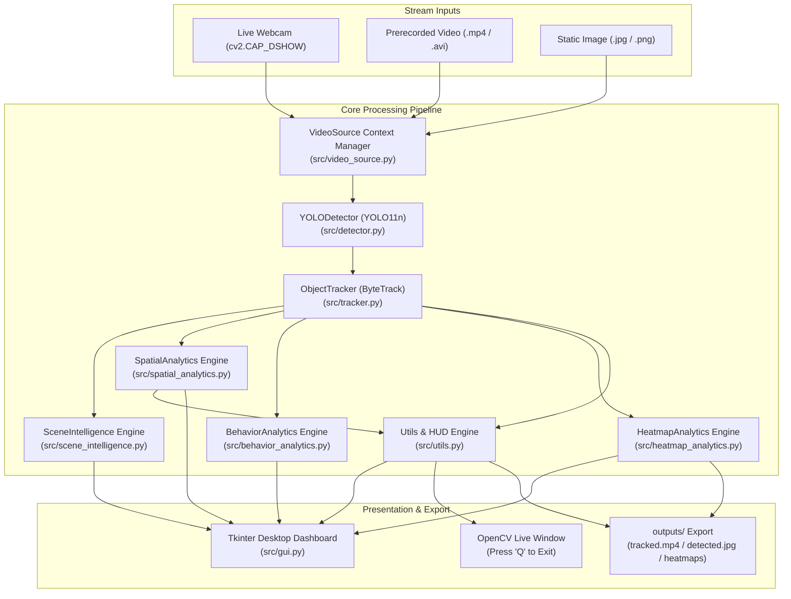

# CodeAlpha AI Internship — Task 4: Object Detection and Tracking

> **Real-Time Multi-Object Detection and Tracking with Ultralytics YOLO & ByteTrack**

[](https://www.python.org/)
[](https://docs.ultralytics.com/)
[](https://github.com/ifzhang/ByteTrack)
[](https://opencv.org/)
[](https://pytorch.org/)
[]()
[](LICENSE)

---

## 📌 Project Overview

This repository contains the complete implementation of **Task 4: Object Detection and Tracking** for the **CodeAlpha AI Internship**.

The application detects, tracks, and analyzes objects across consecutive video frames from **live webcams**, **prerecorded video files**, and **static photographs**. It integrates state-of-the-art **Ultralytics YOLO (YOLO11n)** for deep learning inference with **ByteTrack** for temporal ID association, accompanied by a **desktop GUI dashboard**, a **CLI interface**, an **explainable Scene Intelligence engine**, **virtual line-crossing & region analytics**, **trajectory behavior analytics**, and **spatial occupancy heatmaps**.

> [!NOTE]
> **Pretrained Weights & ID Semantics**: The system employs official pretrained COCO weights (`yolo11n.pt`). Tracking IDs (e.g., `#1`, `#2`) are temporal stream identifiers assigned dynamically across consecutive frames using Kalman filter state prediction and Hungarian linear assignment. They are valid for the duration of the stream and are not persistent biometric or biometric facial recognizers.

---

## 🏗️ System Architecture



---

## ✨ Key Features

* **Real-Time Object Detection**: Inference with bounding boxes, confidence scores, and COCO class classifications via pretrained YOLO11n.
* **ByteTrack Multi-Object Tracking**: Associative tracking preserving persistent IDs across consecutive frames with zero ID hopping.
* **Virtual Line-Crossing & Region Analytics**: Geometric 2D line crossing detection with directional classification (`A_TO_B`, `B_TO_A`, `TOP_TO_BOTTOM`, `BOTTOM_TO_TOP`, `LEFT_TO_RIGHT`, `RIGHT_TO_LEFT`), dual-boundary hysteresis jitter suppression ($\pm 8.0\text{px}$), and rectangular ROI entry/exit/occupancy tracking with track-loss discrimination and state recovery.
* **ROI Dwell Time & Peak Occupancy**: Continuous elapsed dwell monitoring for active visits, class-specific average dwell times, and historical peak occupancy telemetry with frame/timestamp attribution.
* **Explainable Scene Intelligence**: Snapshot counting, jitter-filtered motion direction estimation (`Stationary`, `Moving Left`, `Moving Right`, `Moving Up`, `Moving Down`), structured event timeline logging (`ENTERED`, `MOVED`, `EXITED`), and deterministic natural-language scene summaries without external LLM dependencies.
* **Trajectory Behavior Analytics**: Euclidean path length, net displacement, direction changes with angular filtering, and numerically stable tortuosity bounded $\ge 1.0$ alongside nominal speed reporting ($px/s$).
* **Spatial Occupancy Heatmaps**: Continuous 2D Gaussian density accumulation, optional temporal decay, non-destructive video frame overlay blending, and export of standalone colormap and blended PNGs with path collision prevention.
* **Interactive Desktop GUI Dashboard**: Dark-themed desktop dashboard built with Tkinter and Pillow featuring threaded video streaming, start/stop controls, live scene intelligence cards, spatial analytics counters, trajectory behavior dynamics, spatial heatmap controls, view-mode toggling (`Tracking Stream`, `Heatmap Overlay`, `Heatmap Density`), and one-click output directory opening.
* **Live Webcam Streaming**: DirectShow webcam integration on Windows supporting camera index selection and responsive `Q` / `Esc` keyboard exit handlers.
* **Prerecorded Video Processing**: Process `.mp4`, `.avi`, `.mov`, and `.mkv` files with automated video export to `outputs/`.
* **Single-Image Verification**: Fast CLI mode to verify detection accuracy on static photographs.
* **Resource Safety & Graceful Recovery**: Python context managers ensuring OpenCV video streams, writer handles, and GUI worker threads release cleanly on exit.

---

## 🛠️ Technology Stack

| Component | Library / Framework | Version | Purpose |
| :--- | :--- | :--- | :--- |
| **Language** | Python | `3.13.2` | Core programming language |
| **Object Detection** | Ultralytics YOLO | `8.4.177` (YOLO11n) | Object detection & classification |
| **Object Tracking** | ByteTrack / BoT-SORT | Built-in (`lap 0.5.13`) | Multi-object association & ID assignment |
| **Spatial Analytics** | Pure Python & NumPy | Built-in | 2D vector cross-products, hysteresis boundaries, ROI occupancy, dwell & peak tracking |
| **Scene Intelligence** | Pure Python & NumPy | Built-in | Centroid motion vectors, timeline events, explainable summaries |
| **Behavior Analytics** | Pure Python & NumPy | Built-in | Trajectory metrics: path length, displacement, tortuosity, direction turns, speed ($px/s$) |
| **Heatmap Analytics** | OpenCV & NumPy | Built-in | 2D Gaussian density splatting, decay, colormapped export, and alpha overlay blending |
| **Computer Vision** | OpenCV (`opencv-python`) | `5.0.0` | Frame acquisition, image manipulation, DirectShow capture |
| **Tensors** | PyTorch & Torchvision | `2.14.1+cpu` | Neural network computation (with CUDA fallback) |
| **GUI Framework** | Tkinter + Pillow (`PIL`) | Built-in / `12.3.0` | Native desktop dashboard |
| **Testing** | PyTest | `9.1.1` | Automated test suite (175 unit & integration tests) |

---

## 📂 Project Structure

```text
CodeAlpha_Object_Detection_Tracking/
├── app.py                         # Unified CLI and application controller
├── requirements.txt               # Pinned project dependencies
├── README.md                      # Project documentation & usage guidelines
├── .gitignore                     # Excluded environments, weights, outputs, and caches
├── .vscode/
│   └── settings.json              # VS Code Python interpreter binding
├── src/
│   ├── __init__.py                # Package root
│   ├── detector.py                # YOLODetector: model loader & inference engine
│   ├── tracker.py                 # ObjectTracker & TrackedObject: ByteTrack association
│   ├── scene_intelligence.py     # SceneIntelligence: rule-based motion analytics & events
│   ├── spatial_analytics.py      # SpatialAnalytics: line crossing, ROI occupancy, dwell & hysteresis
│   ├── behavior_analytics.py     # BehaviorAnalytics: path length, displacement, tortuosity & speed
│   ├── heatmap_analytics.py      # HeatmapAnalytics: Gaussian density accumulation & overlay export
│   ├── video_source.py            # VideoSource: webcam & file stream context manager
│   ├── utils.py                   # HUD rendering, bounding boxes, palettes, FPS meter
│   └── gui.py                     # Desktop GUI dashboard & background tracking worker
├── tests/
│   ├── __init__.py                # Test suite init
│   ├── test_project_setup.py      # 23 automated baseline and architecture tests
│   ├── test_scene_intelligence.py # 13 deterministic scene intelligence tests
│   ├── test_spatial_analytics.py  # 40 deterministic line-crossing, ROI dwell & peak tests
│   ├── test_behavior_analytics.py # 30 trajectory metrics, speed, tortuosity & lifecycle tests
│   ├── test_heatmap_analytics.py  # 46 Gaussian accumulation, overlay & export tests
│   └── test_heatmap_gui.py        # 23 GUI worker, view-mode toggles & hardening tests
├── assets/                        # Test media (sample_bus.jpg, sample_clip.mp4)
├── models/                        # Pretrained YOLO weights (yolo11n.pt) [git-ignored]
└── outputs/                       # Annotated output videos, images & heatmaps [git-ignored]
```

---

## 🚀 Setup & Installation

### 1. Prerequisites
* Python 3.10+ (Tested on Python 3.13.2 64-bit on Windows 11)
* Git

### 2. Virtual Environment Setup

```powershell
# Navigate to project directory
cd CodeAlpha_Object_Detection_Tracking

# Create virtual environment
python -m venv venv

# Activate on Windows PowerShell:
.\venv\Scripts\Activate.ps1
# Or on Command Prompt:
.\venv\Scripts\activate.bat
```

### 3. Install Dependencies

```powershell
pip install -r requirements.txt
```

---

## 💻 Usage & Running

### Mode 1: Launch the Interactive Desktop GUI Dashboard

```powershell
.\venv\Scripts\python.exe app.py --gui
```

* **Dashboard Controls & Configuration**:
  * **Stream Source**: Select **Webcam** (with camera index spinbox) or **Video File** (with file browser prefilled to `assets/sample_clip.mp4`).
  * **Model Configuration**: Choose YOLO weights (`yolo11n.pt` or `yolov8n.pt`) and tracker algorithm (`bytetrack.yaml` or `botsort.yaml`).
  * **Confidence Threshold**: Real-time slider from `0.05` to `1.0`.
  * **Save Annotated Output**: Checkbox to toggle video export to `outputs/`.
  * **Virtual Line & ROI Analytics**: Checkbox to enable line-crossing and ROI occupancy overlays and counters.
  * **Spatial Heatmap**:
    * **Enable Heatmap**: Checkbox to activate spatial density accumulation.
    * **Radius & Opacity**: Adjust Gaussian footprint radius (`5` to `200` px) and blending opacity (`0.1` to `1.0`).
    * **Custom Dir & 📂 Open**: Choose an optional custom export folder or click **📂 Open** upon completion to view exported heatmap images directly in Windows File Explorer.
  * **View Mode Toolbar**:
    * **Tracking Stream**: Standard live stream with bounding boxes, IDs, trajectories, HUD, and spatial line/ROI overlays.
    * **Heatmap Overlay**: Live blended preview of spatial density over video frames.
    * **Heatmap Density**: Pure colorized colormap representation of cumulative entity footprints.
  * **Live Analytics Cards**: Processing FPS, Active Objects, Total Unique IDs, Scene Intelligence Summary, Spatial Line/ROI Counts, Trajectory Behavior Dynamics (Avg Length, Displacement, Tortuosity, Turns, Speed), Spatial Heatmap Points & Peak Density, and Real-Time Activity Log.
  * **Execution**: Click **▶ Start Tracking** to initiate background processing; click **⏹ Stop Tracking** to halt and save outputs cleanly.

---

### Mode 2: Prerecorded Video Tracking (CLI)

```powershell
# Standard ByteTrack multi-object tracking on sample clip (saves annotated video to outputs/)
.\venv\Scripts\python.exe app.py --source assets/sample_clip.mp4 --model yolo11n.pt --tracker bytetrack.yaml --save

# Limit processing to first 45 frames for rapid testing
.\venv\Scripts\python.exe app.py --source assets/sample_clip.mp4 --max-frames 45 --save
```

---

### Mode 3: Spatial Line-Crossing & Rectangular ROI Analytics (CLI)

```powershell
# Run with default demonstration virtual line (50,300,590,300) and ROI (100,150,540,420)
.\venv\Scripts\python.exe app.py --source assets/sample_clip.mp4 --spatial-demo --max-frames 45 --save

# Run with custom virtual line and ROI coordinates: --line "x1,y1,x2,y2" --roi "x1,y1,x2,y2"
.\venv\Scripts\python.exe app.py --source assets/sample_clip.mp4 --line "50,240,590,240" --roi "120,100,520,380" --max-frames 45 --save
```

---

### Mode 4: Spatial Heatmap & Trajectory Behavior Analytics (CLI)

```powershell
# Enable spatial occupancy heatmap accumulation and trajectory behavior analytics
.\venv\Scripts\python.exe app.py --source assets/sample_clip.mp4 --spatial-demo --heatmap --max-frames 45 --save

# Export heatmaps to a custom directory instead of default outputs/
.\venv\Scripts\python.exe app.py --source assets/sample_clip.mp4 --heatmap --heatmap-dir "outputs/heatmaps" --max-frames 45 --save
```

* **Output Artifacts Generated**:
  * `outputs/tracked_sample_clip.mp4`: Full annotated video with bounding boxes, track IDs, trajectory trails, line/ROI overlays, and HUD.
  * `outputs/heatmap_sample_clip.png`: Standalone normalized 3-channel colormapped density visualization.
  * `outputs/heatmap_overlay_sample_clip.png`: Non-destructive alpha overlay blended onto the stream frame.

---

### Mode 5: Single-Image Object Detection (CLI)

```powershell
# Run YOLO11n detection on sample image and save annotated result to outputs/
.\venv\Scripts\python.exe app.py --source assets/sample_bus.jpg --model yolo11n.pt --conf 0.25 --save
```

* **Output Artifact**: Saves `outputs/detected_sample_bus.jpg` with labeled bounding boxes and prints class distributions and bounding box coordinates to the console.

---

### Mode 6: Live Interactive Webcam Tracking (CLI)

```powershell
# Run live tracking on default webcam (index 0) with OpenCV visualization window
.\venv\Scripts\python.exe app.py --source 0 --model yolo11n.pt --conf 0.25

# Save webcam session video with spatial demo overlays and heatmaps
.\venv\Scripts\python.exe app.py --source 0 --spatial-demo --heatmap --save
```

* **Keyboard Controls**:
  * Press **`q`** or **`Q`** to exit the camera stream gracefully.
  * Press **`Esc`** to quit and release camera hardware safely.
* **Headless Mode**: Pass `--headless` to run webcam capture headlessly for automated environments without opening an OpenCV window.

---

## ⚙️ CLI Parameter Reference

The following table reflects the complete set of CLI arguments supported by `app.py`:

| Argument | Type | Default | Description |
| :--- | :---: | :---: | :--- |
| `--gui` | Flag | `False` | Launches the interactive Tkinter desktop GUI dashboard. |
| `--source` | String | `"0"` | Input source: webcam index (`0`, `1`), or path to an image or video file. |
| `--model` | String | `"yolo11n.pt"` | Pretrained YOLO weights filename or path (cached in `models/`). |
| `--tracker` | String | `"bytetrack.yaml"` | Multi-object tracker configuration (`bytetrack.yaml` or `botsort.yaml`). |
| `--conf` | Float | `0.25` | Detection confidence threshold between `0.0` and `1.0`. |
| `--device` | String | `"cpu"` | Computation device: `"cpu"` or `"cuda"` (auto-falls back to CPU if CUDA unavailable). |
| `--save` | Flag / Path | `None` | Save output: pass flag alone for default in `outputs/` or specify custom file path. |
| `--max-frames`| Integer | `None` | Optional maximum number of video frames to process. |
| `--line` | String | `None` | Virtual line coordinates `"x1,y1,x2,y2"` for directional crossing detection. |
| `--roi` | String | `None` | Rectangular ROI coordinates `"x1,y1,x2,y2"` for occupancy, entry, exit, and dwell analytics. |
| `--spatial-demo`| Flag | `False` | Enables default demonstration virtual line and ROI overlays and counters. |
| `--heatmap` | Flag | `False` | Enables spatial occupancy heatmap accumulation and image exports for video/webcam. |
| `--heatmap-dir` | String | `None` | Optional custom directory to save heatmap and overlay images (default: `outputs/`). |
| `--headless` | Flag | `False` | Run webcam capture headlessly without opening an OpenCV visualization window. |

---

## 📊 Measured Performance & Benchmarks

All performance measurements below were executed directly on host CPU hardware (Intel/AMD x64 CPU on Windows 11):

| Mode / Input | Hardware Mode | Cold Start (Model Init) | Sustained Latency | Sustained Throughput |
| :--- | :---: | :---: | :---: | :---: |
| **Webcam Stream (640×480)** | CPU (`PyTorch 2.14.1+cpu`) | `3.14 s` | `94.7 ms` / frame | **`10.56 FPS`** |
| **Prerecorded Video (720×1280)** | CPU (`PyTorch 2.14.1+cpu`) | `2.80 s` | `136.6 ms` / frame | **`7.31 FPS`** |
| **Static Photo (810×1080)** | CPU (`PyTorch 2.14.1+cpu`) | `2.10 s` | `2.32 s` (single frame) | N/A |

> [!TIP]
> **GPU Acceleration**: On systems equipped with an NVIDIA GPU and CUDA drivers installed, running with `--device cuda` reduces inference latency to <15 ms per frame, enabling 60+ FPS processing.

---

## 🧠 Phase A — Advanced Scene Intelligence

The system includes an explainable, rule-based **Scene Intelligence** layer ([`src/scene_intelligence.py`](src/scene_intelligence.py)) that sits on top of ByteTrack temporal association. It transforms raw spatial coordinates into explainable metrics, temporal timeline events, and deterministic natural-language summaries.

### 1. Scene Snapshot & Cumulative Metrics
* Tracks currently visible objects per frame alongside total cumulative entities observed throughout the stream session.
* Maintains per-class counts (`person`, `car`, `bus`, etc.) updated every frame without duplicate ID inflation.

### 2. Motion Direction Estimation & Jitter Suppression
* Tracks Euclidean centroid displacement $(\Delta x, \Delta y)$ across a moving window:
  $$\text{Displacement} = \sqrt{(\Delta x)^2 + (\Delta y)^2}$$
* **Jitter Filter**: Centroid drift under $12.0\text{px}$ is categorized as `STATIONARY`, eliminating detection noise and bounding box jitter.
* **Dominant Direction Axis**: When net movement $\ge 12.0\text{px}$, the engine decomposes motion into 4 coarse vectors:
  * $|\Delta x| \ge |\Delta y|$: `MOVING_LEFT` ($\Delta x < 0$) or `MOVING_RIGHT` ($\Delta x > 0$)
  * $|\Delta y| > |\Delta x|$: `MOVING_UP` ($\Delta y < 0$) or `MOVING_DOWN` ($\Delta y > 0$)

### 3. Structured Event Timeline Logging
Emits three deterministic event types logged to GUI and CLI feeds:
* `ENTERED`: Emitted when a new tracking ID is first registered in the scene.
* `MOVED`: Emitted when an entity exhibits persistent directional motion. Throttled (every 20 frames or upon direction change) to prevent event flood.
* `EXITED`: Emitted when an object disappears for $\ge 15$ consecutive frames, or when the video stream finalizes.

### 4. Deterministic Natural-Language Summaries
* Generates human-readable, factual summaries synthesized directly from tracked observations (e.g., *"Observed 5 distinct objects (4 persons, 1 bus) across 30 frames. Currently visible (5)... Motion highlights: #1 bus covered ~142px."*).
* Zero ungrounded generative hallucinations: runs 100% locally on CPU without external API keys or LLMs.

---

## 📐 Phase B — Virtual Line-Crossing & Region Analytics

The system features a dedicated spatial-analytics layer ([`src/spatial_analytics.py`](src/spatial_analytics.py)) that computes geometric line-crossing detections, rectangular Region of Interest (ROI) occupancy metrics, and dwell time analytics.

### 1. Mathematical Formulation of Line Crossing

Given a virtual line segment $L$ connecting endpoints $P_1(x_1, y_1)$ and $P_2(x_2, y_2)$, and consecutive centroid positions $C_{prev}(x_{prev}, y_{prev})$ and $C_{curr}(x_{curr}, y_{curr})$:

1. **Signed Perpendicular Distance**:
   $$d(P) = \frac{(x_2 - x_1)(y - y_1) - (y_2 - y_1)(x - x_1)}{\sqrt{(x_2 - x_1)^2 + (y_2 - y_1)^2}}$$

2. **Hysteresis Band & Boundary Jitter Suppression**:
   A dual-sided hysteresis dead-band of $\pm h$ ($h = 8.0\,\text{px}$) prevents false crossings caused by sensor noise:
   * **Side A**: $d(P) > +h$
   * **Neutral / Dead Zone**: $-h \le d(P) \le +h$
   * **Side B**: $d(P) < -h$
   A crossing is confirmed only when an entity moves strictly from outside one hysteresis boundary to beyond the opposing boundary.

3. **Trajectory Segment Straddle & Intersection**:
   The trajectory segment $\overline{C_{prev} C_{curr}}$ must geometrically intersect the finite segment $\overline{P_1 P_2}$ (with an endpoint tolerance $\epsilon = 0.15$ for oblique tracks).

4. **Directional Semantics**:
   * **Horizontal Lines** ($|x_2 - x_1| \ge |y_2 - y_1|$): Classified as `TOP_TO_BOTTOM` or `BOTTOM_TO_TOP`.
   * **Vertical Lines** ($|y_2 - y_1| > |x_2 - x_1|$): Classified as `LEFT_TO_RIGHT` or `RIGHT_TO_LEFT`.
   * **Arbitrary Diagonal Lines**: Classified as `A_TO_B` or `B_TO_A` relative to the line orientation vector.

### 2. Rectangular Region of Interest (ROI) Analytics & Dwell Time

Configured as a bounding box $[x_1, y_1, x_2, y_2]$:

1. **Dual-Boundary Spatial Hysteresis**:
   * **Inner Entry Boundary**: $R_{inner} = [x_1 + h, y_1 + h, x_2 - h, y_2 - h]$
   * **Outer Exit Boundary**: $R_{outer} = [x_1 - h, y_1 - h, x_2 + h, y_2 + h]$
   An object enters only upon crossing inside $R_{inner}$, and exits only upon crossing completely outside $R_{outer}$.

2. **Track-Loss vs. Boundary Exit Discrimination (`TERMINATED_INSIDE`)**:
   A critical failure mode of naive ROI trackers is counting an "exit" when an object simply disappears or is occluded while still standing inside the zone. The system enforces strict spatial attribution:
   * **Boundary Exit (`ROI_EXIT`)**: Emitted **only** when an active track's centroid is observed transitioning from inside $R_{inner}$ to strictly outside $R_{outer}$.
   * **Detection Loss / Stream Conclusion (`TERMINATED_INSIDE`)**: If a track is lost (unseen for $\ge 10$ frames) or if the stream concludes while the entity is inside the ROI, it transitions to `TERMINATED_INSIDE`. It is logged separately and is **never** counted as a false exit.
   * **Re-entry Recovery**: If an entity marked `TERMINATED_INSIDE` reappears solidly outside $R_{outer}$, its state cleanly recovers to `OUTSIDE`, allowing subsequent valid entries.

3. **Dwell Duration & Peak Occupancy**:
   * Tracks active visit records from entry timestamp to exit timestamp.
   * Maintains class-specific dwell time averages and global peak concurrent occupancy records with frame and timestamp attribution.

---

## 🔥 Phase C — Trajectory Behavior Analytics & Spatial Heatmaps

Phase C introduces fine-grained geometric motion metrics and spatial density accumulation across video frames.

### 1. Trajectory Behavior Analytics ([`src/behavior_analytics.py`](src/behavior_analytics.py))

* **Path Length ($px$)**: Sum of Euclidean distances between consecutive valid centroid observations along the trajectory:
  $$\text{Path Length} = \sum_{i=1}^{N-1} \sqrt{(x_{i+1} - x_i)^2 + (y_{i+1} - y_i)^2}$$
* **Net Displacement ($px$)**: Straight-line Euclidean distance between the initial and final observed trajectory positions:
  $$\text{Displacement} = \sqrt{(x_N - x_1)^2 + (y_N - y_1)^2}$$
* **Tortuosity ($\ge 1.0$)**: Dimensionless ratio measuring path curvature and winding complexity:
  $$\text{Tortuosity} = \frac{\text{Path Length}}{\max(\text{Displacement}, \epsilon)}$$
  * A straight-line path yields a tortuosity of exactly $1.0$.
  * Meandering, curved, or looping paths yield tortuosity $> 1.0$.
  * Numerically stable with an $\epsilon = 3.0\text{px}$ guard and a ceiling cap of $100.0$ to eliminate division-by-zero on stationary tracks or closed loops.
* **Direction Changes**: Detects meaningful turns by segmenting trajectories into minimum segment lengths ($\ge 6.0\text{px}$) and registering turns where the vector angle deflection equals or exceeds $45^\circ$, discarding sub-pixel detector jitter.
* **Average Speed ($px/s$)**: Evaluated strictly as path length divided by elapsed stream time. If timestamps are missing or invalid, speed safely reports `None` with an explainable fallback reason.

### 2. Spatial Occupancy Heatmaps ([`src/heatmap_analytics.py`](src/heatmap_analytics.py))

* **2D Gaussian Density Accumulation**: Entity centroids are accumulated into a continuous float32 density accumulator via normalized 2D radial Gaussian kernels:
  $$G(x, y) = \exp\left(-\frac{(x - c_x)^2 + (y - c_y)^2}{2\sigma^2}\right), \quad \sigma = \frac{r}{2}$$
* **Temporal Decay Support**: Optional per-frame decay factor $\lambda \in (0.0, 1.0]$ allows focusing on transient motion patterns.
* **Non-Destructive Alpha Overlay**: Blends colormapped density onto stream frames without modifying the underlying frame array:
  $$\text{Frame}_{blended} = (1 - \alpha) \cdot \text{Frame} + \alpha \cdot \text{Colormap}$$
  Pixels below a normalized density threshold ($0.05$) remain uncolored and pristine.
* **Defensive Path Collision & Cleanup**: Automatically rejects path collisions with input sources or output videos, handles existing file naming with counter suffixes, and unlinks intermediate files if an overlay write fails.

---

## ⚠️ Important Limitations & Technical Clarifications

* **CPU Inference Throughput**: On host CPUs (`PyTorch 2.14.1+cpu`), sustained inference throughput ranges between $7$ and $11\text{ FPS}$ depending on frame resolution. It is interactive and responsive, but 30+ FPS real-time processing requires CUDA GPU acceleration.
* **Nominal Stream Timing & Pixel Speed**: In prerecorded video processing, timestamps reflect container nominal time ($\text{frame} / \text{fps}$). All speeds are reported as **pixels per nominal second ($px/s$)** in the 2D image plane. They represent image-plane motion rather than calibrated physical-world velocity (km/h or mph).
* **Track Loss vs. Physical Exit**: Track disappearance due to detector miss, occlusion, or stream conclusion is classified as `TERMINATED_INSIDE`. It is not assumed to be a confirmed physical departure through a boundary.
* **Heatmap Density Semantics**: Spatial heatmaps represent the cumulative spatial frequency of detected entity centroids in pixel space. They are **not** thermal infrared temperature maps, optical flow velocity fields, or instance segmentation masks.
* **GUI Preview Throttling vs. Accumulation**: In the desktop GUI, preview frames for the overlay and density views are generated at frame 1 and every 15 frames to maintain smooth rendering. The underlying density accumulator updates **every single frame** without skipping any observations.

---

## 🧪 Automated Test Suite

The project includes an automated test suite comprising **175 unit, regression, and integration tests** across 6 specialized modules.

```powershell
# Run the complete test suite with verbose output
.\venv\Scripts\python.exe -m pytest tests -v
```

### Test Coverage Breakdown:

| Test File | Test Count | Scope & Subsystems Verified |
| :--- | :---: | :--- |
| `tests/test_project_setup.py` | **23** | Python environment compatibility, YOLO detector lazy loading, ByteTrack lifecycle, synthetic frame pipelines, VideoSource context manager. |
| `tests/test_scene_intelligence.py` | **13** | Multi-class snapshot counting, jitter suppression (12px), 4-direction motion vectors, timeline events (`ENTERED`, `MOVED`, `EXITED`), deterministic natural language summaries. |
| `tests/test_spatial_analytics.py` | **40** | String coordinate parsing, line crossing geometry, hysteresis boundary deadband, ROI entry/exit cycles, dwell durations, peak occupancy, `TERMINATED_INSIDE` discrimination, bounded history preservation. |
| `tests/test_behavior_analytics.py` | **30** | Euclidean path length, net displacement, speed calculation & fallbacks, tortuosity numerical stability ($\ge 1.0$), direction changes with angle filters, multi-lifecycle reuse. |
| `tests/test_heatmap_analytics.py` | **46** | 2D Gaussian kernel splatting, decay factor, boundary clamping, non-destructive overlay blending, density thresholding, reset isolation. |
| `tests/test_heatmap_gui.py` | **23** | GUI tracking worker lifecycle, view-mode toggling, preview throttling without accumulation loss, export path collision rejection, zero-frame handling, failed-write cleanup. |
| **Total** | **175 Passing** | **100% automated test pass rate with zero failures or warnings.** |

---

## 🔧 Troubleshooting & Common Questions

1. **Webcam Backend on Windows**:
   * Windows utilizes the DirectShow backend (`cv2.CAP_DSHOW`) automatically for fast, reliable hardware initialization. If multiple cameras are attached, select `--source 1` or specify the camera index in the GUI.
2. **Missing Video File Error**:
   * Provide a valid file path or use forward slashes / escaped backslashes (e.g. `assets/sample_clip.mp4`).
3. **Weight Caching**:
   * Pretrained weights (`yolo11n.pt`) are downloaded automatically on first use into `models/` and are strictly excluded from Git tracking via `.gitignore`.
4. **Heatmap Directory Configuration**:
   * By default, heatmaps are exported to `outputs/`. Use `--heatmap-dir <path>` or the GUI "Dir" selector to route heatmaps and overlays to an alternate folder.

---

## 👨‍💻 Author & Internship Details

* **Organization**: CodeAlpha
* **Internship**: Artificial Intelligence Internship
* **Task**: Task 4 — Object Detection and Tracking
* **Author**: Nathin Gowda K G
